# ElectroNova 2026 – Line Follower & Pick-and-Place Robot 🤖

> **Team Error 404** · Track: **Robotics & Automation** · 24-Hour National Level Hackathon · **11–12 April 2026**
> *ElectroNova – Integrating IoT, Robotics and VLSI Intelligence*
> Hosted by the IEEE Electron Devices Society (EDS) Student Branch Chapter, Department of Electronics & Communication, **Acropolis Institute of Technology and Research, Indore**

🌐 Event website: https://ieee-eds-electronovahackathon.vercel.app/

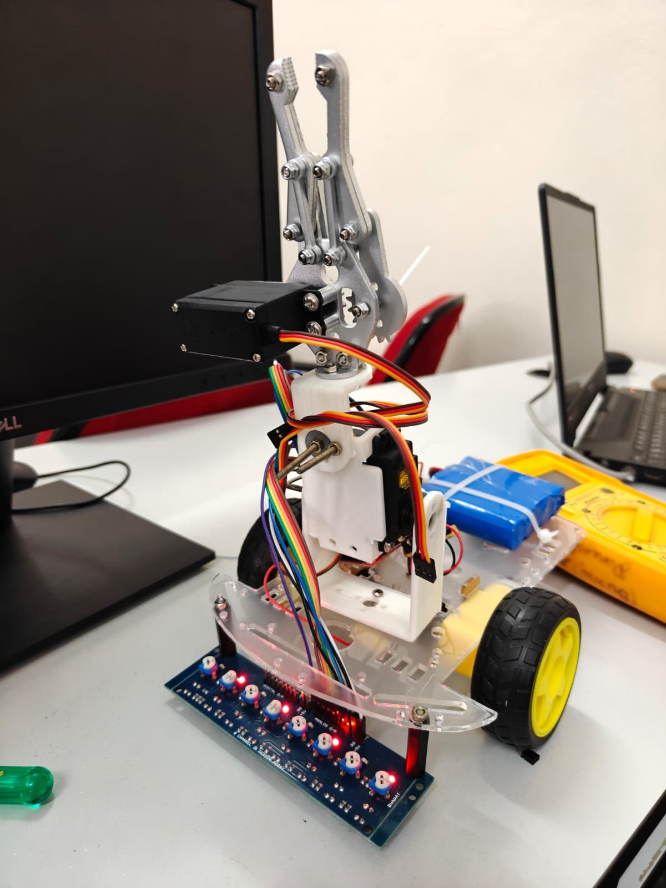

---

## 📑 Table of Contents
1. [About the Hackathon](#-about-the-hackathon)
2. [Problem Statement](#-problem-statement)
3. [Our Solution](#-our-solution)
4. [Demo](#-demo)
5. [Team](#-team-error-404)
6. [Hardware](#-hardware)
7. [Pin Connections](#-pin-connections)
8. [Code](#-code)
9. [How It Works](#️-how-it-works)
10. [Calibration](#-calibration)
11. [How to Run](#️-how-to-run)
12. [Gallery](#️-gallery)
13. [Certificate](#-certificate)
14. [Future Improvements](#-future-improvements)

---

## 🏆 About the Hackathon

ElectroNova is a flagship technical event of the IEEE EDS Student Branch Chapter at Acropolis, focused on innovation in electronics, semiconductor devices and intelligent engineering systems. Participants solve real-world problems across three tracks:

| Track | Rounds |
|---|---|
| **Robotics & Automation** *(our track)* | 1. Online Quiz & Idea Presentation → 2. Simulation & Hardware Build → 3. Final Model Presentation |
| VLSI Design | Online Quiz & Design Proposal → EDA Simulation / FPGA Implementation → Final Design Presentation |
| Internet of Things | Online Quiz & Idea Screening → IoT Simulation / Hardware Build → Final Project Demonstration |

Total prize pool: ₹75,000. The on-site hackathon ran for 24 hours with food and stay arranged for participants.

---

## 🎯 Problem Statement

Our track (Robotics & Automation) had **two phases** on a printed arena:

| Phase | Task |
|---|---|
| **Phase 1** | Build a robot that follows a line. |
| **Phase 2** | Line following **plus pick and place** using a servo gripper. |

---

## 💡 Our Solution

A two-wheel-drive robot with an **8-channel IR sensor array** for line detection, an **Arduino + L298N** for control and a **2-servo arm with gripper** mounted on the chassis for pick and place.

- Sensors read the line as an 8-bit pattern (black = `1`, white = `0`).
- Pattern matching decides forward / left / right / stop.
- In Phase 2, an all-black marker square stops the robot, which then picks (first marker) or places (second marker) the object with the gripper.

---

## 🎥 Demo

| Video | What it shows |
|---|---|
| [▶️ `robot-working-demo.mp4`](media/videos/robot-working-demo.mp4) | Working model on the hackathon arena (Phase 2 pick & place run) |
| [▶️ `line-follower-testing.mp4`](media/videos/line-follower-testing.mp4) | Team testing the robot on the track |
| [▶️ `night-badminton.mp4`](media/videos/night-badminton.mp4) | Late-night break 🏸 |

> 💡 GitHub doesn't play `.mp4` links inline. Click the file and use the play button on the file page.

---

## 👥 Team Error 404

| Member | Contribution |
|---|---|
| **Bhanu Pratap Singh Rajpoot** | Hardware assembly, sensor calibration |
| **Parth Marotkar** | Support during hardware setup |
| **Krish Jain** | Coding |
| **Ashwathy Nair** | Coding |
| **Bhavya Pahadiya** | Team member |

---

## 🧰 Hardware

| Component | Details |
|---|---|
| Microcontroller | Arduino Uno (or compatible) |
| Line sensor | 8-channel IR sensor array (digital output) |
| Motor driver | L298N dual H-bridge |
| Drive | 2 × DC gear motors with yellow wheels, acrylic 2-wheel chassis |
| Arm | Metal gripper claw + tilting base bracket, 2 servo motors |
| Power | Li-ion battery pack |

---

## 🔌 Pin Connections

**IR sensor array (left → right)**

| Sensor | S1 | S2 | S3 | S4 | S5 | S6 | S7 | S8 |
|---|---|---|---|---|---|---|---|---|
| Arduino pin | A0 | A1 | A2 | D5 | D6 | D7 | D8 | D9 |

**L298N motor driver**

| L298N pin | Arduino pin | Purpose |
|---|---|---|
| ENA | D3 (PWM) | Left motor speed |
| IN1 | D2 | Left motor direction |
| IN2 | D4 | Left motor direction |
| ENB | D11 (PWM) | Right motor speed |
| IN3 | D10 | Right motor direction |
| IN4 | D12 | Right motor direction |

**Servos (Phase 2)**

| Servo | Arduino pin |
|---|---|
| Gripper | D13 |
| Arm (lift / tilt) | A3 |

⚠️ Power the servos from a proper 5–6 V supply, not the Arduino 5 V pin, and join all grounds.

---

## 💻 Code

| Folder | Description |
|---|---|
| [`code/phase1_line_follower`](code/phase1_line_follower/phase1_line_follower.ino) | Phase 1 – 8-sensor line follower (the hackathon code) |
| [`code/phase2_pick_and_place`](code/phase2_pick_and_place/phase2_pick_and_place.ino) | Phase 2 – line follower + servo pick & place |
| [`code/servo_calibration`](code/servo_calibration/servo_calibration.ino) | Helper to find the correct servo angles |

> **Note on Phase 2 code:** the original servo code written during the hackathon was lost. The Phase 2 sketch in this repository was **re-written after the event** for the same hardware, reusing the Phase 1 line-following logic. Pins and servo angles may need adjustment for your own build – use the calibration sketch first.

---

## ⚙️ How It Works

### Line following (Phase 1 and 2)

| Sensor pattern (S1…S8) | Meaning | Action |
|---|---|---|
| `00011000`, `00111100`, `01111110` | Line centred | **Forward** (PWM 80) |
| Line toward the right, e.g. `00000011`, `00001111` | Robot drifted left | **Turn right** (left motor off, right PWM 60) |
| Line toward the left, e.g. `11000000`, `11110000` | Robot drifted right | **Turn left** (right motor off, left PWM 60) |
| Anything else (e.g. all white) | Line lost | **Stop** |

### Pick & place (Phase 2)

```
Follow line ──► all 8 sensors black for 150 ms? ──► STOP
                                                     │
              1st marker ◄────────────────────────────┤
   open gripper → arm down → close gripper → arm up  (PICK)
                 → drive off the marker → keep following the line
                                                     │
              2nd marker ◄────────────────────────────┘
   arm down → open gripper → arm up → close gripper  (PLACE) → DONE
```

Servo movements are swept 1° at a time so the object isn't jerked. All angles, delays and speeds are constants at the top of the sketch.

---

## 🎛️ Calibration

1. **IR sensors:** put the robot on the track and turn the potentiometer on each sensor until it outputs `1` on black and `0` on white. Uncomment the Serial print block in the Phase 1 sketch to see the 8 values at 9600 baud.
2. **Servos:** upload `servo_calibration.ino`, open the Serial Monitor (9600 baud, *Newline*) and type `g60` / `a110` etc. to find the gripper open/closed and arm up/down angles. Copy them into `phase2_pick_and_place.ino` (`GRIP_OPEN`, `GRIP_CLOSED`, `ARM_UP`, `ARM_DOWN`).

---

## ▶️ How to Run

1. Install the **Arduino IDE** (or VS Code with the Arduino / PlatformIO extension).
2. Open the sketch you want – `phase1_line_follower.ino` or `phase2_pick_and_place.ino`.
3. Select the board (Arduino Uno) and port, then upload.
4. Place the robot on a white surface with a black line. The sketch waits 2 s after power-on.
5. Tune `SPEED_FORWARD` / `SPEED_TURN` for your motors and track.

---

## 🖼️ Gallery

### The robot
| | |
|---|---|
|  | 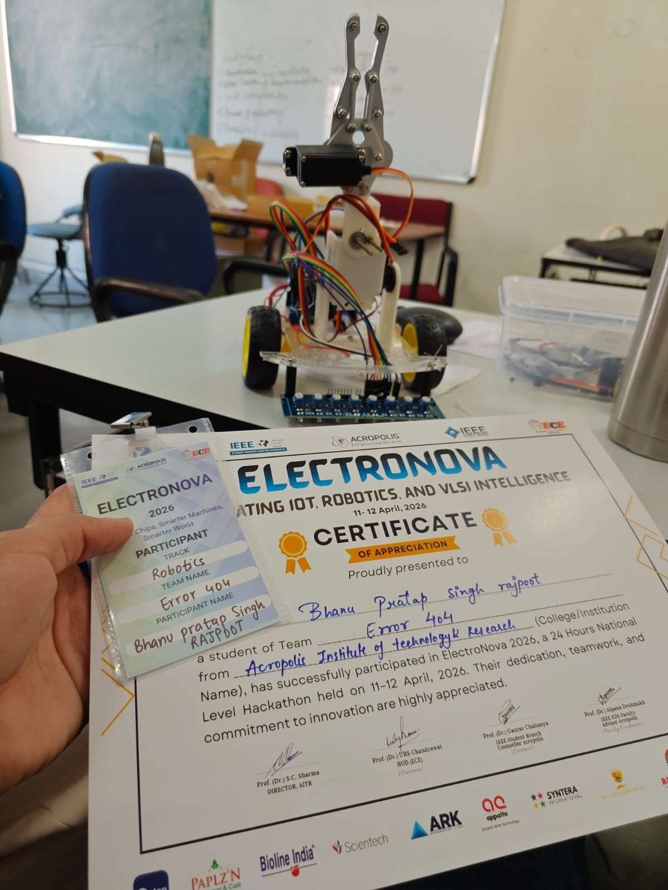 |

### Building & testing – 24 hours of work
| | |
|---|---|
| 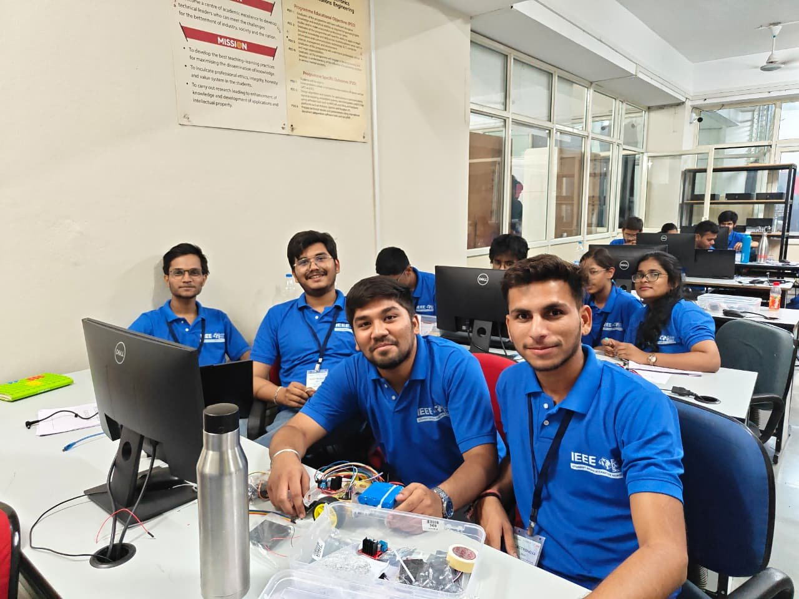 | 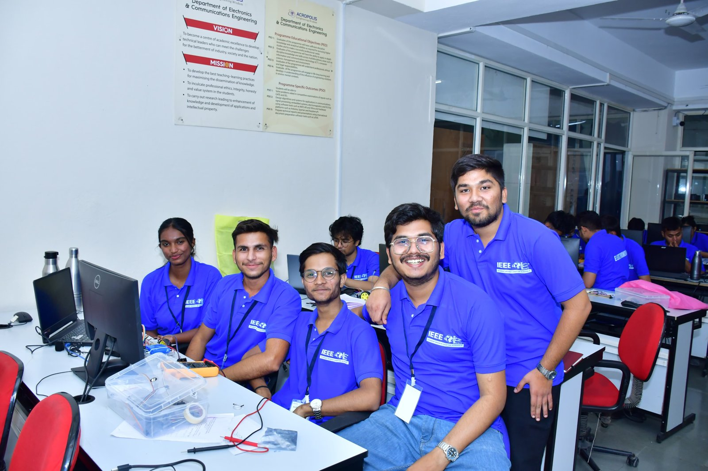 |
| 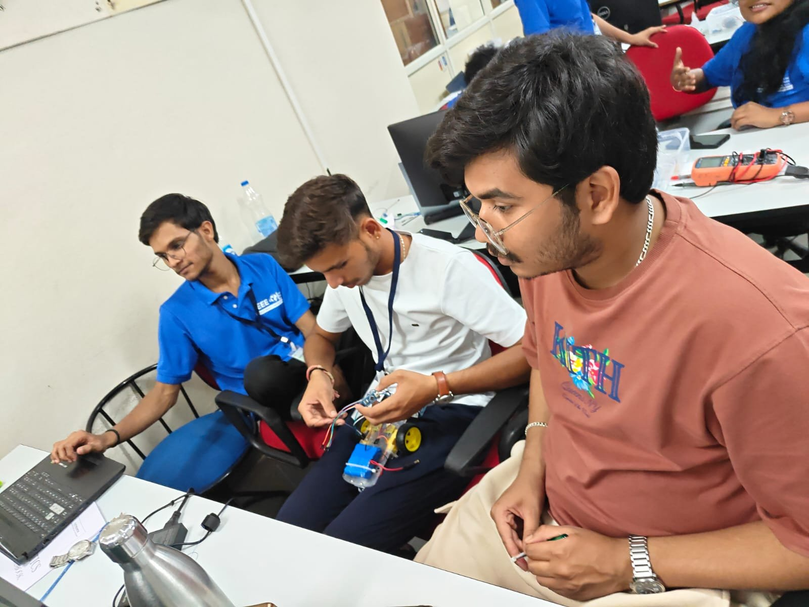 | 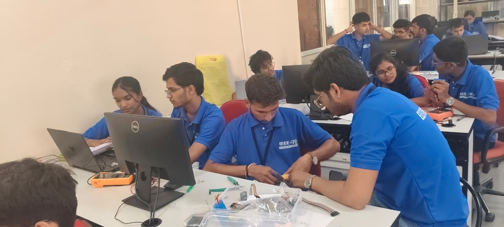 |

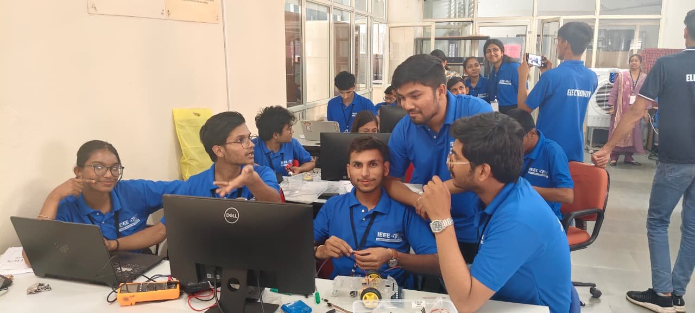

### The event
| | |
|---|---|
| 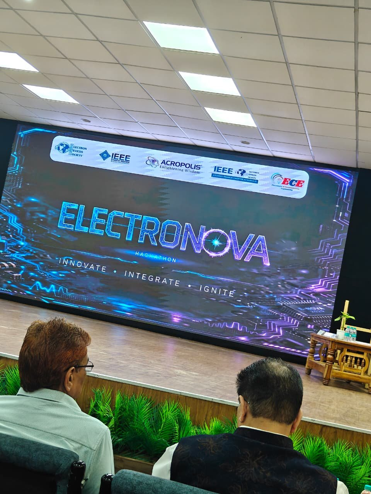 | 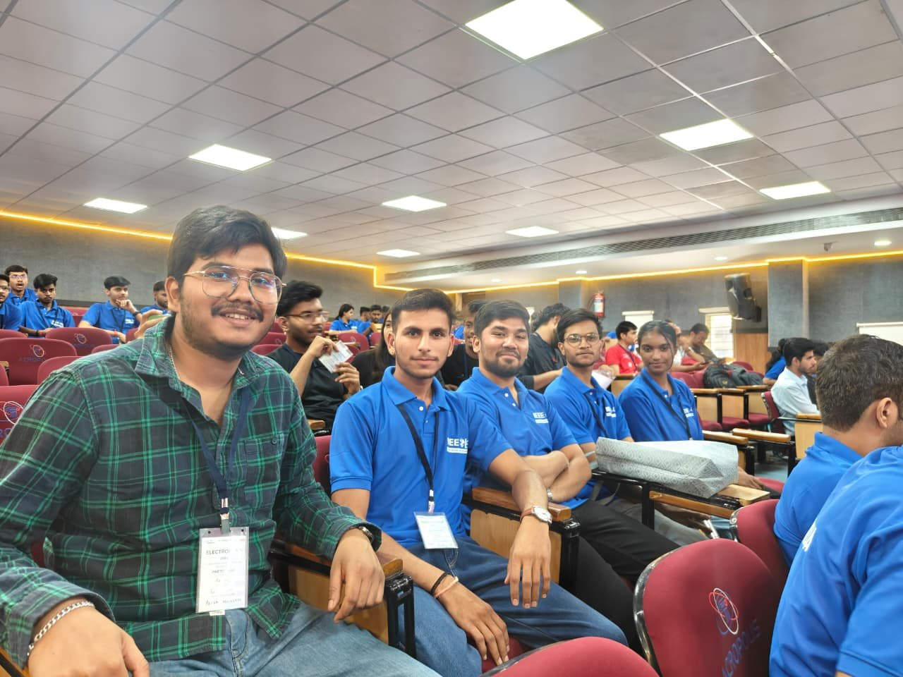 |

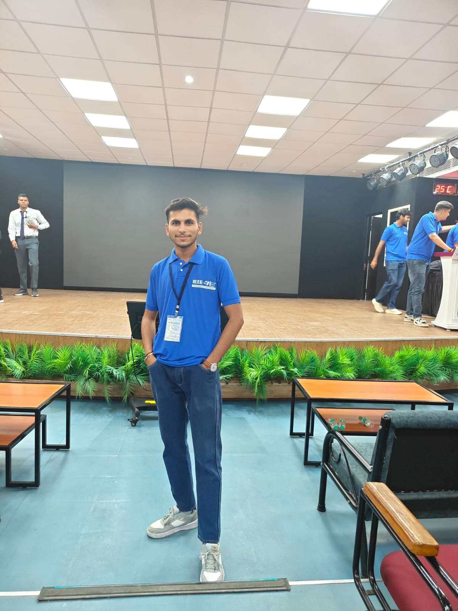

### 🌙 Night life at the hackathon
Breakfast, lunch and dinner were provided, stay was arranged, and we found time for fun after dark.

| | |
|---|---|
| 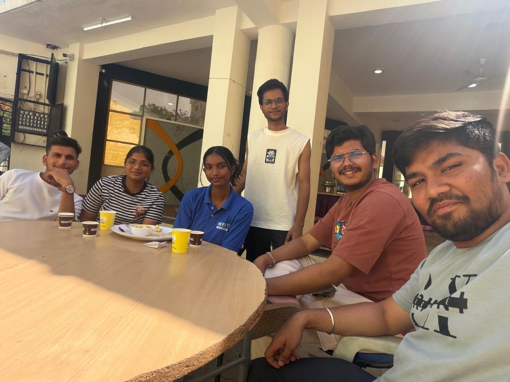 | 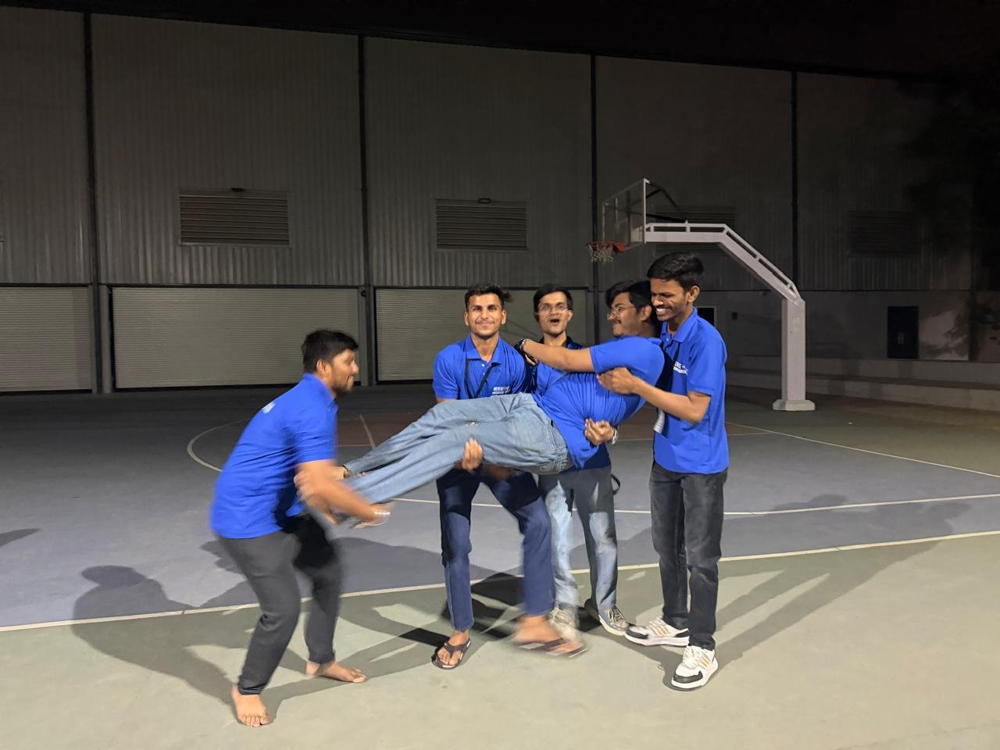 |

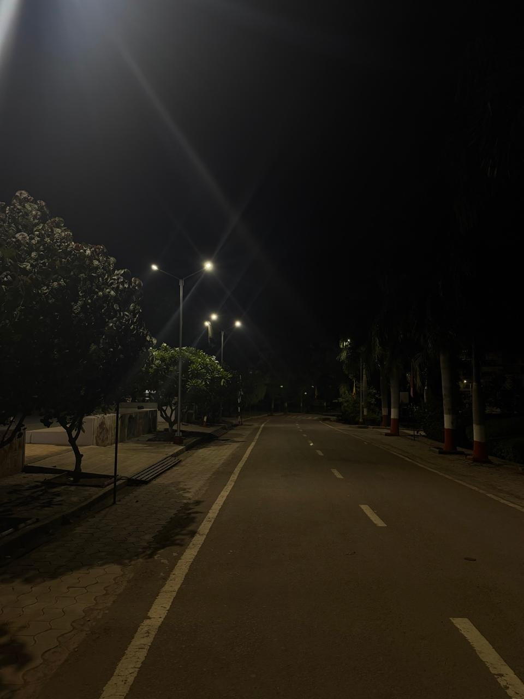

---

## 🏅 Certificate

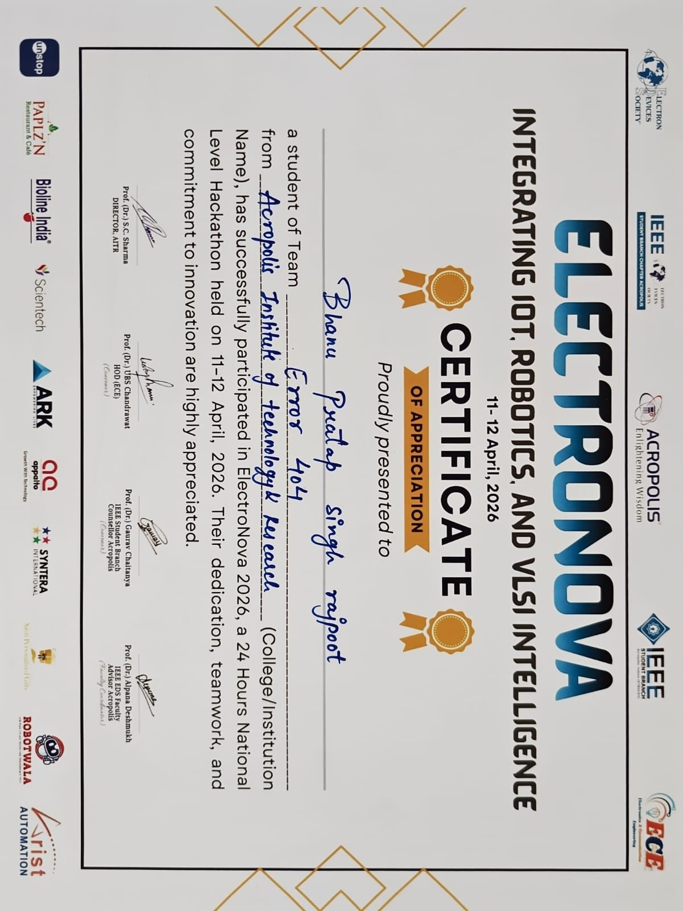

---

## 🚀 Future Improvements

- PID control for smoother line following instead of fixed pattern matching
- Junction detection and line-lost recovery
- Use an object-detection sensor (ultrasonic / IR) to trigger the pick automatically
- Wireless monitoring with ESP32 / Bluetooth (IoT integration)

---

## 📁 Repository Structure

```
electronova-2026-line-follower-robot/
├── README.md
├── LICENSE
├── code/
│   ├── phase1_line_follower/phase1_line_follower.ino
│   ├── phase2_pick_and_place/phase2_pick_and_place.ino
│   └── servo_calibration/servo_calibration.ino
└── media/
    ├── robot/
    ├── team-work/
    ├── event/
    ├── fun/
    ├── certificate/
    └── videos/
```

## 🙏 Acknowledgements

Thanks to the **IEEE EDS Student Branch Chapter, Acropolis** and the organising team for ElectroNova 2026, and to every teammate for an unforgettable 24 hours.

## 📜 License

Released under the [MIT License](LICENSE).
